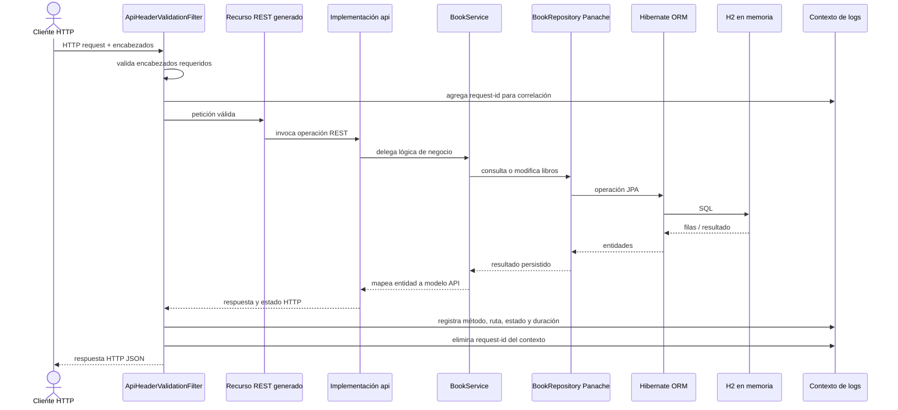

# Diagrama de secuencia de una petición REST con persistencia

## Flujo de inicialización

1. Quarkus crea el esquema a partir de las entidades JPA conforme a `quarkus.hibernate-orm.schema-management.strategy`.
2. Hibernate ejecuta `src/main/resources/import.sql` e inserta los registros iniciales.
3. Al procesar una petición, el servicio consulta o modifica esas filas mediante el repositorio Panache.
