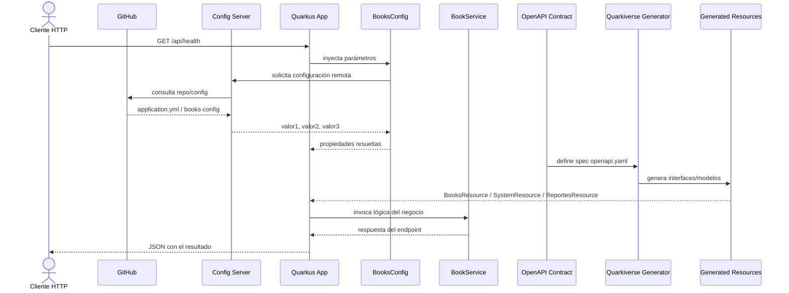

# Diagrama de secuencia del flujo de configuración y API

## Descripción

1. El cliente hace una petición HTTP a la API.
2. La app Quarkus necesita configuración y la obtiene del Config Server.
3. El Config Server puede leer el contenido desde GitHub.
4. La app inyecta esos valores a través de `BooksConfig` usando `@ConfigProperty`.
5. El contrato OpenAPI se usa como fuente de verdad para generar la API.
6. El generator crea las interfaces JAX-RS y modelos.
7. La lógica de negocio se ejecuta en `BookService` y responde al cliente.

## Observación

Si el Config Server no está disponible, la app puede usar los valores locales definidos en `application.properties` como fallback. En entorno real, la configuración remota suele encargarse de proveer los valores del sistema.
