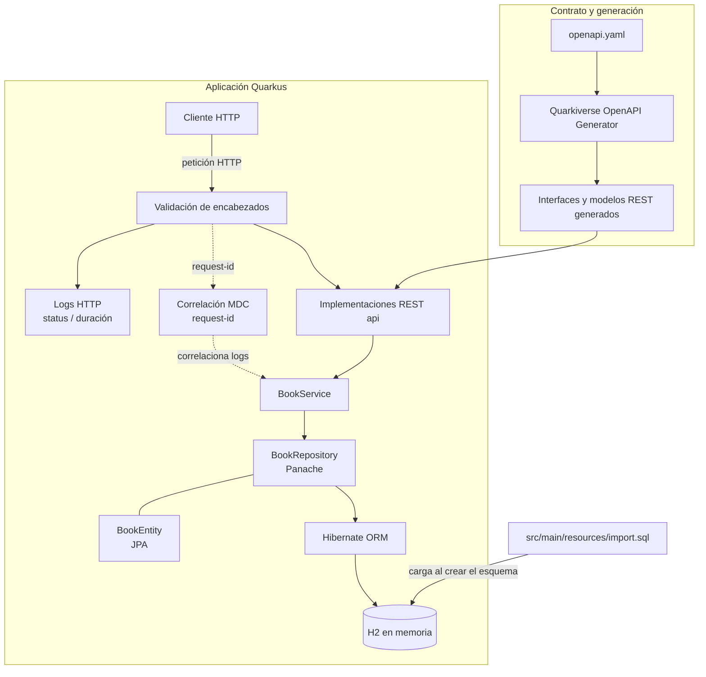

# Diagrama visual del flujo de la aplicación

## Interpretación visual

- El contrato OpenAPI genera las interfaces REST y modelos usados por las implementaciones.
- La petición pasa por el filtro de encabezados y llega a la capa `api/`.
- `BookService` delega las operaciones a `BookRepository`, que usa Hibernate ORM y entidades JPA.
- H2 almacena libros; los datos iniciales se insertan desde `import.sql` al crear el esquema.
- La base H2 es en memoria y sus datos duran solo mientras vive el proceso.
