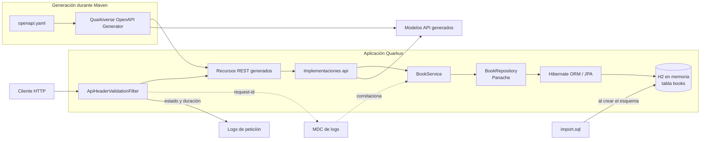

# Arquitectura y flujo de la aplicación

## Descripción del flujo

1. Durante la generación/build, `openapi.yaml` produce interfaces de recursos y modelos API; no se editan manualmente.
2. El cliente HTTP llama a los endpoints REST. `ApiHeaderValidationFilter` valida los encabezados requeridos, guarda `request-id` en MDC y registra el inicio de la petición.
3. La implementación REST delega a `BookService`; este aplica la lógica de negocio y transacciones.
4. `BookRepository` accede a `BookEntity` mediante Panache y Hibernate ORM.
5. Hibernate persiste y consulta libros en H2. Los reportes de disponibilidad y libros por autor consultan los datos persistidos.
6. Al crearse el esquema, Hibernate ejecuta `src/main/resources/import.sql` para insertar los libros iniciales.
7. Al completar la respuesta, el filtro registra método, ruta, estado HTTP y duración; los eventos quedan correlacionados con `request-id`. El MDC se limpia al finalizar la petición.

La conexión y la estrategia de esquema se configuran en `src/main/resources/application.yaml`. H2 es en memoria: los datos no se conservan al terminar el proceso.
