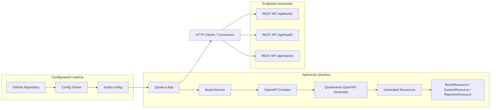

# Diagrama de flujo de la aplicación

## Descripción del flujo

1. El repositorio de GitHub guarda la configuración externa del servicio.
2. El Config Server consulta y sirve ese archivo de configuración, por ejemplo `books-config`.
3. La aplicación Quarkus se conecta al Config Server usando la propiedad:
   `quarkus.spring-cloud-config.url=http://localhost:8888`
4. La app inyecta esos valores con `@ConfigProperty` y los usa en `BooksConfig` y `BookService`.
5. La API REST se entrega desde el contrato OpenAPI ubicado en `src/main/resources/openapi/openapi.yaml`.
6. El Quarkiverse OpenAPI Generator crea las interfaces y modelos JAX-RS a partir del contrato.
7. La aplicación implementa la lógica en clases como `BooksResourceImpl`, `SystemResourceImpl` y `ReportesResourceImpl`.
8. Los clientes consumen los endpoints REST generados por la aplicación.

## Nota importante

En desarrollo local, la aplicación puede usar valores locales definidos en `application.properties` si el Config Server no está disponible. En producción o entorno real, la configuración remota del Config Server suele sobrescribir esos valores.
